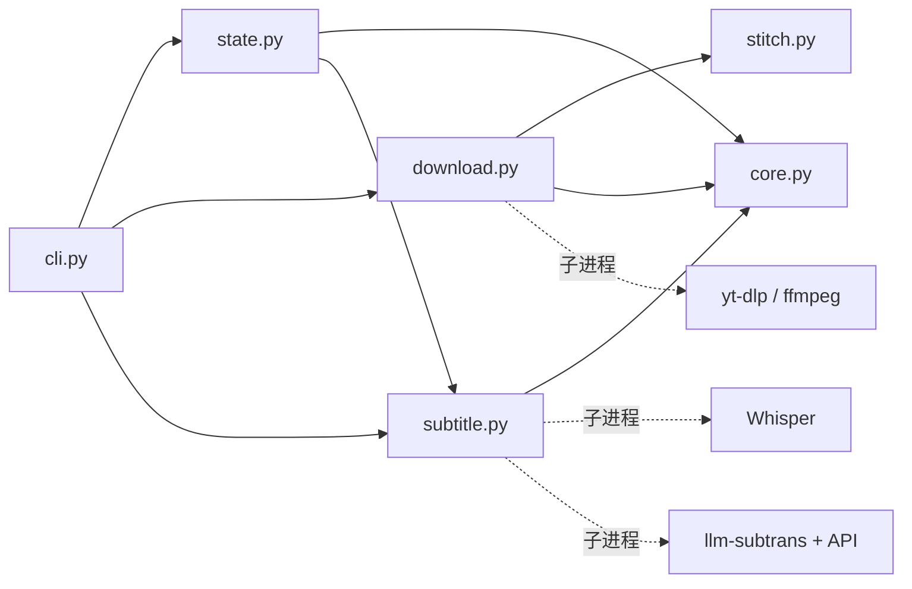
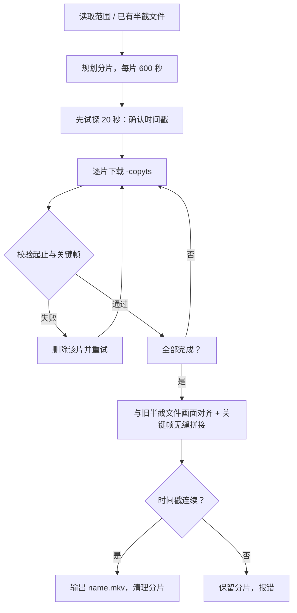

# taneko 架构（v0.1）

## 1. 代码目录（`D:\Ops_OPC\framework\`）

```
framework/
├── taneko.py                 入口（python taneko.py ...）
├── README.md
├── ARCHITECTURE.md           本文件
├── config/
│   ├── asr.json              Whisper：模型、设备、分句长度
│   └── translate.json        翻译：接口、模型、通用要求
├── tests/
│   └── test_taneko.py        5 个测试（SRT、完成判断、检查点、重跑跳过）
└── taneko/
    ├── cli.py                命令：run / status / approve / 各单独阶段
    ├── state.py              流程计划 + 每阶段"做完了吗"的判断
    ├── core.py               路径、meta.json、SRT 读写、外部工具查找
    ├── download.py           fetch：分片下载、校验、重试、续传
    ├── stitch.py             拼接：旧半截文件对齐、关键帧无缝合并
    ├── subtitle.py           subs / asr / terms / fix / translate / check
    └── asr_run.py            在 Whisper 的 venv 里运行的转写脚本
```

## 2. 依赖关系和外部工具

```
cli ──→ state ──→ core
 │        └─────→ subtitle ──→ core
 ├──────→ download ──→ stitch
 │            └─────→ core
 └──────→ subtitle

外部工具（只被子进程调用，不链接）：
  download  → yt-dlp、ffmpeg、ffprobe、Firefox cookies
  subtitle  → Whisper（D:\Tools\whisper）、llm-subtrans（workflow\vendor）、API 密钥（环境变量）
```

## 3. 一次 `run` 的流程

```
fetch ──→ asr（或 subs）──→ terms ──→ ⏸ 术语校对 ──→ fix ──→ translate ──→ check ──→ ⏸ 抽查 ──→ 完成
 │          │                 │          │                │        │           │          │
 视频.mkv   en.srt           terms.txt   你填              en.srt   zh.srt     通过/报错   你放行
                                         corrections       改好                           (approve)
                                         → approve terms

  · 每步先问 state："做完了吗？" 是就跳过，否就执行
  · 中文原文（source_lang=zh）只走 fetch → asr
  · 重跑同一条命令 = 续跑
```

## 4. 项目文件夹（`projects\<项目>\`）

```
meta.json        项目配置：来源、片段范围、术语表、检查点放行记录（review）
<name>.mkv       下载完成的视频
_parts\          下载中的分片（完成后自动删除）
en.srt           英文字幕（转写或抓取）
en.srt.orig      fix 之前的备份
terms.txt        高频专有名词清单
zh.srt           中文字幕
```

## 5. 阶段的“完成”标准

| 阶段 | 判定为完成 |
|---|---|
| fetch | 有视频、没有 `_parts`、时长不比预期短（长视频容差 25 秒，短的按 1%） |
| asr / subs | `en.srt`（中文原文是 `zh.srt`）存在且非空 |
| terms | `terms.txt` 存在 |
| ⏸ 术语 | `meta.review.terms` 为真（`taneko approve <项目> terms`） |
| fix | 没有 corrections 则跳过（status 显示 `–`），否则 `en.srt.orig` 存在 |
| translate | `zh.srt` 存在 |
| check | 中英条数、时间轴一一对应，字数不超读速 |
| ⏸ 抽查 | `meta.review.spot` 为真（`taneko approve <项目> spot`） |

## 6. 留在旧 `workflow\` 的部分（暂未纳入框架）

```
workflow\pipeline.py   probe（4K/Hi-Res 质检）、chapters、upload、subtitle（B 站字幕轨）、login
workflow\vendor\       llm-subtrans（框架通过 TANEKO_VENDOR 指向它）
```

## 7. 设计原则

- 阶段只读写项目文件夹，不互相调用；顺序由 `state.plan` 决定。
- 失败只影响当前阶段（下载按分片，其余按文件），重跑即续。
- 需要人判断的地方做成检查点，而不是绕过去。
- 外部工具都以子进程调用，框架本身只用 Python 标准库。
- 密钥只走环境变量，不写文件。

## 8. Mermaid 图

### 8.1 模块依赖



### 8.2 run 的流程与检查点


### 8.3 fetch 的分片下载与续传


