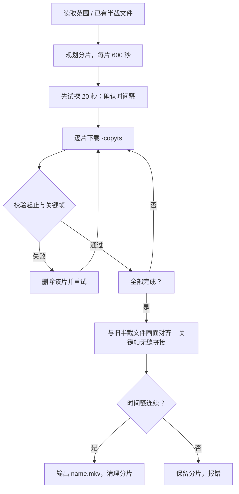

# taneko 架构

## 1. 核心只有一个概念：阶段

流程里的每一步都是一个阶段（`core.Stage`），一个阶段一个文件，只回答四个问题：

| 字段 | 回答 |
|---|---|
| `name` / `label` | 叫什么 |
| `done(项目目录, meta)` | 做完了吗（只在这里定义一次） |
| `run(参数)` | 怎么做 |
| `args(子命令)` | 单独运行时的选项；`run` 调用它时用的也是这些默认值 |

现在只有一个阶段：`fetch`。加一个阶段 = 在 `stages/` 里加一个文件，并把它放进 `flow.STAGES`。

## 2. 分层

```
cli          命令行：init / run / status / doctor，加上每个阶段的单独命令
 └ flow      排顺序、跳过做完的；不知道任何阶段的内部
    └ stages fetch
       └ project · stitch · ranges · hls
          └ core   路径、退出码、错误、Stage 约定、外部工具
```

规则（测试 `Layers` 会检查）：

- 依赖只往下走，下层不引用上层。
- 阶段之间互不引用。
- 阶段出错只抛出 `core.Fail`，不自己退出程序；由 `cli` 打印“错误：……”，并以退出码 1 退出。

外部工具都以子进程调用，不链接：fetch 用 yt-dlp、ffmpeg 和浏览器 cookies。

## 3. 一次 `run`

- 每一步先问 `done`：做完了就跳过，没做完就执行。所以重跑同一条命令，就是接着跑。
- 退出码：成功是 0，出错是 1，参数不对是 2。

## 4. 项目文件夹 `projects/<项目>/`

命令里的项目可以是名字，也可以是路径（含 `/` 或 `\`，或者就是 `.`）。名字在 `projects/` 下最多 3 层里找，`_` 和 `.` 开头的文件夹跳过；同名的有多个时报错，不猜。`run` 只找一次，之后把路径交给各阶段。

```
meta.json        项目配置：来源、片段范围、下载设置
<name>.mkv       下载完成的视频
_parts/          下载中的分片（完成后自动删除）
```

## 5. 每个阶段的“做完了”

| 阶段 | 做完了 |
|---|---|
| fetch | 有视频、没有 `_parts`、时长不比预期短（长视频容差 25 秒，短的按 1%；和下载代码自己的判断还不一致，见 issue #1） |

## 6. fetch：按索引下载、分片下载与续传

只下一段时，先按索引下载（`ranges.py`）：用 yt-dlp 取格式的地址，读 MP4 的 `sidx` 或 WebM 的 Cues，算出这段时间的字节范围，用 HTTP Range 每次 10 MiB 顺序下到 `_parts/*.part`，旁边的 `.json` 记着范围，重跑从已下的字节接着下。下完用 ffmpeg 不重新编码地切到这一段（视频从起点前的关键帧开始，音频也从这个关键帧下、从这里开始，开头才不会没声音），`verify` 通过才替换成品。格式是 HLS 播放列表（例如 X）时按播放列表下载（`hls.py`）：只下覆盖这一段的分片，一片一个文件，重跑跳过已下完的，下完按顺序拼成一个文件再切；分片的时间戳可能不从 0 开始，切的时候用视频第一片对齐播放列表的时间。两种都不行（直播、加密、按字节范围存放的分片），或加了 `--sections`，才走下面的分片下载。



## 7. 不在本仓库的部分

作者旧的工作流脚本里还有一些功能，暂未迁入：画质检查（4K / Hi-Res）、章节、B 站上传、登录。字幕不做，交给 VideoLingo、pyvideotrans 这类专门的工具。
