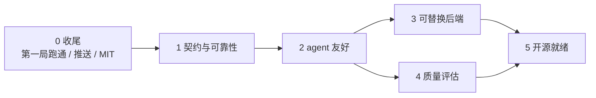

# taneko Roadmap

> 记录日期：2026-11-15 · 状态：草案，待与实际运行数据对照后修订。评分为作者的主观判断。

## 接下来（按顺序）

顺序只在这里定，issue 里只写细节。开着的 issue 最多 7 个，规则见 [AGENTS.md](AGENTS.md)。

重点是音视频。字幕是实验性功能，暂停开发（见下面“暂停”）。

1. issue #5：换一台机器也能装好。`doctor`、`init` 已完成；下一步 `pyproject.toml` 和 PyPI
2. 按索引下载扩展到其他网站（B 站、X），先实测它们的格式有没有索引

已完成：issue #8（按索引下载一段，速度和整条下载一样，断了接着下）、修复 2026-11-16 之前拼接的 5 个视频的声音空白、issue #1（接缝处的音频、统一的“完成”标准、整条视频直接下载）、issue #6（行数检查）、issue #4（`status --json`、报错说清楚怎么办）。

## 暂停：字幕（实验性）

转写、术语、修正、翻译、检查这几步还能用，但不再开发，也不保证质量。下面这些问题随字幕一起暂停，对应的 issue 已关闭，恢复开发时重新打开：

- issue #2：重做前面的步骤后，旧的人工放行仍然有效；`fix` 只跑一次；`en.srt` 改了不会重译
- issue #3：只下载一段时，`subs` 抓来的字幕可能整体错位（未验证）
- issue #7：可替换的转写后端（whisper.cpp、Modal）；转写不能续传
- 翻译按 200 条一段各自送去翻译，段与段之间没有上下文；翻译工具写的剧情摘要会搞错队伍（2026-11-15 在第一局看到）

## 1. 现状评估

### 对人（Human）：约 6/10

| 已经做到 | 还差 |
|---|---|
| 一条命令 `run`，`status` 看进度 | 安装全靠手动（ffmpeg、yt-dlp、deno、Whisper、翻译工具），没有环境体检（issue #5） |
| 两个人工检查点会停下并给出下一步 | 术语校对要手改 `meta.json`，易写错格式 |
| 下载、转写、翻译都能断点续传（翻译按段存盘） | ~~新框架没有 `init`（新建项目）~~（已完成，issue #5） |
| 报错具体 | 报错默认“发给助手”，对外用户不友好；提示只有中文（issue #4） |
| README 如实标注验证状态和已知问题 | 默认路径绑在作者自己的目录结构上（issue #5） |
| 密钥只走环境变量，`taneko key` 管理 | “抽查”只是放行开关，没有挑选抽查片段的工具 |

### 对 agent：约 4/10

优点：阶段幂等、状态在磁盘文件里、人工检查点能拦住 agent、代码小且只用标准库。

已确认的缺陷：

1. ~~`run` 的退出码无法区分“完成”和“在等人”~~：已解决，完成=0、需要人工=10、出错=1、参数错误=2（见 README 的退出码）。
2. ~~缺少密钥时翻译会弹输入框，agent 会一直挂着~~：已解决，非交互终端下会直接报错并提示 `taneko key set`；密钥输入全程不显示。
3. `status` 没有 `--json`，只有给人看的中文输出（issue #4）。
4. 仓库里没有 `AGENTS.md`（哪些命令安全、哪些绝不能做、何时必须停下问人）。
5. 报错没有错误码，难以自动判断怎么修（issue #4）。
6. 重做前面的步骤后，旧的人工放行仍然有效，agent 可能带着没审过的字幕走完流程（issue #2）。

### 质量尚未量化

`check` 只查结构（条数、时间轴、读速）。翻译质量、术语命中率、英雄名是否正确，目前全靠人工抽查。

## 2. 路线图

| 阶段 | 内容 | 价值 / 工作量 |
|---|---|---|
| 0 收尾 | 第一局（game 1）走完全流程；~~推送到 GitHub；MIT~~（已完成） | 必做 / 小 |
| 1 契约与可靠性 | ~~退出码约定~~、~~非交互模式~~（已完成）；修 issue #1 #2 #3；`--json`（issue #4）、`taneko doctor`、`init`、路径可配置（issue #5） | 高 / 中 |
| 2 agent 友好 | `AGENTS.md`、错误码、`taneko next`（直接给出下一步命令或“需要人”）；之后评估做成 MCP / Claude Code skill | 高 / 中 |
| 3 可替换后端 | 转写后端（issue #7）：本地 faster-whisper（CUDA）+ whisper.cpp（Metal / Vulkan / CPU，macOS 转写随它一起做），租用云端 GPU（Modal）；翻译（OpenAI 兼容服务）、来源（yt-dlp / 本地文件）；术语表做成可共享的“领域包” | 中 / 大 |
| 4 质量评估 | 术语命中率、读速违规数；高风险行抽样器（人名、数字、击杀）；双语对照静态网页（点时间戳跳转） | 高 / 大 |
| 5 开源就绪 | ~~CI（Ubuntu + Windows + macOS）~~（已完成）、安装脚本 / pipx、提示中英文化、v0.2、PyPI | 中 / 中 |
| 之后 | B 站上传、章节生成等从旧 workflow 迁入，做成插件；第三方转写接口（OpenAI、Groq 等） | 视需求 |

优先级共识：**先做 1 和 2**（改动小，同时提升人和 agent 的体验）；4 要等第一局的真实质量数据再定指标。

## 3. 开放问题（待决定）

1. 定位：主要自用，还是做成别人也能用的开源工具？（决定阶段 3 和 5 的投入）
2. 第一用户：自己手敲命令，还是更多交给 agent 运行？（若是后者，阶段 2 提前）

## 4. 决策记录

| 日期 | 决定 | 备注 |
|---|---|---|
| 2026-11-15 | 项目名 **taneko**（たね子工坊） | Taneko = 种子 + 昭和老派女孩名，对应“旧半截文件当种子”的机制，适合做吉祥物；GitHub 上仅有约 10 个不相关的同名项目；PyPI 可用性待查 |
| 2026-11-15 | 许可证 **MIT** | 在 README 友好请求 Star，但不作为使用条件（MIT 不允许附加条件） |
| 2026-11-15 | 提交身份用 GitHub noreply 邮箱 | 不公开真实邮箱；仓库以单个干净提交公开 |
| 2026-11-15 | 在 Linux 环境开发，在 Windows 上运行 | 代码经 GitHub 同步；视频和项目数据只留在运行的机器上，不进开发环境，也不进仓库 |
| 2026-11-15 | 翻译目前只验证 OpenCode Go 的 `deepseek-v4.1-flash` | 其他 OpenAI 兼容服务理论可用，未测试；OpenCode 专用请求头/参数需在阶段 3 隔离 |
| 2026-11-15 | 人工检查点是流程的一部分 | 术语校对、抽查不可绕过 |
| 2026-11-15 | 程序代码行数：上限 **2,000** 行，封顶 **2,500** 行 | 只统计 `taneko.py` 和 `taneko/` 下的 `.py`（按 `wc -l`，含空行），测试不算；当时 1,384 行（最初误记为 1,173）。超过 2,000 行要在本表写明原因，超过 2,500 行测试失败、不能合并。另：单个文件 ≤400 行，单个函数 ≤80 行（当时已超的 `cmd_fetch` 147 行、`cmd_translate` 88 行要拆分），第三方 Python 依赖保持 0 个。超出时先把非核心功能（B 站上传、章节等）拆成插件，而不是调高上限。检查用的测试：`tests/test_size.py`（2026-11-16 加上，两个超长函数已拆分） |
| 2026-11-15 | taneko 自己的代码保持全部 Python，不改写成 Go / Rust | 顺着生态走：同类 AI 字幕工具（whisperX、Buzz、pyvideotrans、VideoLingo、llm-subtrans）都是 Python，Whisper 也先有 Python 版。ffmpeg、yt-dlp 等外部工具照旧按命令行调用，与语言无关。难点在安装，不在语言：先 PyPI（`pipx` / `uv tool install`）+ `doctor`，一键包等有需要再做（issue #5） |
| 2026-11-15 | Python 版本：开发用 **3.12**，最低支持 **3.11**，CI 加测最新稳定版（`3.x`，见 `.github/workflows/test.yml`） | 3.12 最主流：PyPI 下载量里 yt-dlp 47%、faster-whisper 41%、ctranslate2 37% 来自 3.12，3.11 次之。yt-dlp 2026.10.26 要求 ≥3.11；3.10 已于 2026-10-01 停止维护。不追最新：GPU 库对新版本的支持往往晚几个月。代码不用 3.11 之后才有的功能。转写用的 Whisper venv 是单独的环境，版本可以不同。3.11 于 2027-10 停止维护时，把最低版本提到 3.12 |
| 2026-11-15 | 转写分成“后端”和“断句”两半：后端只返回带时间戳的词，断句始终用 taneko 自己的 `build_cues` | 换后端不改变字幕长度、断句和读速，后面的阶段不用动。后端：faster-whisper（CUDA，已验证）、whisper.cpp（没有 NVIDIA 显卡时的主力）、Modal（租用云端 GPU，跑同一个模型，结果和本地一致）。第三方转写接口违背本地优先，等有人需要再加。实测（速度、听错的名字、字幕卡点）后，若 whisper.cpp 在 CUDA 上不输 faster-whisper，只留 whisper.cpp 一个本地后端（issue #7） |
| 2026-11-15 | 合并方式按改动大小分三档 | 文档和小改动：直接推到 main。改代码：先推分支，CI 通过后快进到 main，不开 PR。开 PR：有外部贡献者、想让另一个模型审代码、发布前要留完整记录。要关的 issue 写在提交信息里（`Closes #N`）。有外部贡献者之后，给 main 开分支保护，要求 CI 通过才能合并 |
| 2026-11-16 | 字幕标为实验性功能，暂停开发；重点放在音视频 | 第一局实测时，翻译结果对不上，一时修不好。下载和拼接是这个项目的核心，先把它做扎实。字幕的代码保留、照常能跑，相关 issue（#2、#3、#7）关闭并记在“暂停”一节 |
| 2026-11-16 | 下载方式按要下载的时长占全片的比例来定，不按文件大小切片 | 同一条音频实测：整条下载（yt-dlp 自带下载器）8.76 MiB/s，510 MiB 用 58 秒；分段下载（走 ffmpeg）只有约 2 倍实时速度，同样内容要 2 个多小时。整条下载本身就能断点续传（`.part`），按大小切片不会让续传更稳，反而多出接缝（2026-11-16 之前的没声音空白就出在接缝），而且按字节切不准时间点。代价：先整条下载要占更多硬盘 |
| 2026-11-16 | 下载一段改为按索引下载，取代上一条的“按比例选”和“先整条下载再切” | 读文件自带的索引（MP4 `sidx`、WebM Cues），只下这段的字节：实测 140 和 308 都和整条下载一样快（约 8 MiB/s），不多占硬盘，断了接着下。没有现成工具能直接用（yt-dlp 截一段一定走 ffmpeg；`media-seek` 只算字节范围，GPL-3.0），所以自己用标准库写。没有索引的格式仍用分段下载 |
| 2026-11-16 | 程序代码超过 2,000 行（2,072 行），暂不拆分 | 从 issue #8 合并起就超了（加了 `ranges.py`，215 行），这次 issue #5 的 `init` 又加了约 40 行，之前没按规定在这里写明，这次补上。下载这一侧约 1,230 行；已暂停的字幕约 840 行（`asr`、`subs`、`terms`、`fix`、`translate`、`check`、`gates`、`keys`、`srt`、`workers/asr_run`）。到 2,300 行前，先把字幕整体拆成插件，而不是调高上限 |

## 5. 已知限制

- 没有 P2P，不会比单线下载更快，价值在于不丢进度。
- 新框架里的转写、术语、翻译正在 Windows 上用第一局做完整验证；多片并发下载（`--jobs`）已在同一场比赛的另外 4 段视频上跑通。
- 正在跟踪的问题见 [Issues](../../issues)。
- llm-subtrans 只在整次运行结束时才写进度文件，所以 Taneko 自己分段翻译（每 200 条一段，可在 config/translate.json 调整）。
- 翻译工具的虚拟环境绑定安装路径，搬动目录后需要重新登记。
