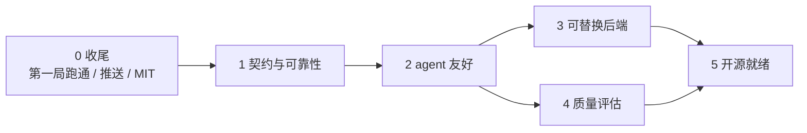

# taneko Roadmap

> 记录日期：2026-11-15 · 状态：草案，待与实际运行数据对照后修订。评分为作者的主观判断。

## 1. 现状评估

### 对人（Human）：约 6/10

| 已经做到 | 还差 |
|---|---|
| 一条命令 `run`，`status` 看进度 | 安装全靠手动（ffmpeg、yt-dlp、deno、Whisper、翻译工具），没有环境体检（issue #5） |
| 两个人工检查点会停下并给出下一步 | 术语校对要手改 `meta.json`，易写错格式 |
| 下载、转写、翻译都能断点续传（翻译按段存盘） | 新框架没有 `init`（新建项目）（issue #5） |
| 报错具体 | 报错默认“发给助手”，对外用户不友好；提示只有中文（issue #4） |
| README 如实标注验证状态和已知问题 | 默认路径绑在作者自己的目录结构上（issue #5） |
| 密钥只走环境变量，`taneko key` 管理 | “抽查”只是放行开关，没有挑选抽查片段的工具 |

### 对 agent：约 4/10

优点：阶段幂等、状态在磁盘文件里、人工检查点能拦住 agent、代码小且只用标准库。

已确认的缺陷：

1. ~~`run` 的退出码无法区分“完成”和“在等人”~~：已解决，完成=0、需要人工=10、出错=1、参数错误=2（见 README 的退出码）。
2. ~~缺少密钥时翻译会弹输入框，agent 会一直挂着~~：已解决，非交互终端下会直接报错并提示 `taneko key set`；密钥输入全程不显示。
3. `status` 没有 `--json`，只有给人看的中文输出（issue #4）。
4. 仓库里没有 `AGENTS.md`（哪些命令安全、哪些绝不能做、何时必须停下问人）。
5. 报错没有错误码，难以自动判断怎么修（issue #4）。
6. 重做前面的步骤后，旧的人工放行仍然有效，agent 可能带着没审过的字幕走完流程（issue #2）。

### 质量尚未量化

`check` 只查结构（条数、时间轴、读速）。翻译质量、术语命中率、英雄名是否正确，目前全靠人工抽查。

## 2. 路线图

| 阶段 | 内容 | 价值 / 工作量 |
|---|---|---|
| 0 收尾 | 第一局（game 1）走完全流程；~~推送到 GitHub；MIT~~（已完成） | 必做 / 小 |
| 1 契约与可靠性 | ~~退出码约定~~、~~非交互模式~~（已完成）；修 issue #1 #2 #3；`--json`（issue #4）、`taneko doctor`、`init`、路径可配置（issue #5） | 高 / 中 |
| 2 agent 友好 | `AGENTS.md`、错误码、`taneko next`（直接给出下一步命令或“需要人”）；之后评估做成 MCP / Claude Code skill | 高 / 中 |
| 3 可替换后端 | 转写（faster-whisper / whisper.cpp）、翻译（OpenAI 兼容服务）、来源（yt-dlp / 本地文件）；术语表做成可共享的“领域包” | 中 / 大 |
| 4 质量评估 | 术语命中率、读速违规数；高风险行抽样器（人名、数字、击杀）；双语对照静态网页（点时间戳跳转） | 高 / 大 |
| 5 开源就绪 | CI（Windows + Ubuntu）、安装脚本 / pipx、提示中英文化、v0.2、PyPI | 中 / 中 |
| 之后 | B 站上传、章节生成等从旧 workflow 迁入，做成插件 | 视需求 |

优先级共识：**先做 1 和 2**（改动小，同时提升人和 agent 的体验）；4 要等第一局的真实质量数据再定指标。

## 3. 开放问题（待决定）

1. 定位：主要自用，还是做成别人也能用的开源工具？（决定阶段 3 和 5 的投入）
2. 第一用户：自己手敲命令，还是更多交给 agent 运行？（若是后者，阶段 2 提前）

## 4. 决策记录

| 日期 | 决定 | 备注 |
|---|---|---|
| 2026-11-15 | 项目名 **taneko**（たね子工坊） | Taneko = 种子 + 昭和老派女孩名，对应“旧半截文件当种子”的机制，适合做吉祥物；GitHub 上仅有约 10 个不相关的同名项目；PyPI 可用性待查 |
| 2026-11-15 | 许可证 **MIT** | 在 README 友好请求 Star，但不作为使用条件（MIT 不允许附加条件） |
| 2026-11-15 | 提交身份用 GitHub noreply 邮箱 | 不公开真实邮箱；仓库以单个干净提交公开 |
| 2026-11-15 | 在 Linux 环境开发，在 Windows 上运行 | 代码经 GitHub 同步；视频和项目数据只留在运行的机器上，不进开发环境，也不进仓库 |
| 2026-11-15 | 翻译目前只验证 OpenCode Go 的 `deepseek-v4.1-flash` | 其他 OpenAI 兼容服务理论可用，未测试；OpenCode 专用请求头/参数需在阶段 3 隔离 |
| 2026-11-15 | 人工检查点是流程的一部分 | 术语校对、抽查不可绕过 |
| 2026-11-15 | 程序代码行数：上限 **2,000** 行，封顶 **2,500** 行 | 只统计 `taneko.py` 和 `taneko/` 下的 `.py`（按 `wc -l`，含空行），测试不算；当时 1,173 行。超过 2,000 行要在本表写明原因，超过 2,500 行测试失败、不能合并。另：单个文件 ≤400 行，单个函数 ≤80 行（当时已超的 `cmd_fetch` 147 行、`cmd_translate` 88 行要拆分），第三方 Python 依赖保持 0 个。超出时先把非核心功能（B 站上传、章节等）拆成插件，而不是调高上限。检查用的测试见 issue #6 |

## 5. 已知限制

- 没有 P2P，不会比单线下载更快，价值在于不丢进度。
- 新框架里的转写、术语、翻译正在 Windows 上用第一局做完整验证；多片并发下载（`--jobs`）已在同一场比赛的另外 4 段视频上跑通。
- 正在跟踪的问题见 [Issues](../../issues)。
- llm-subtrans 只在整次运行结束时才写进度文件，所以 Taneko 自己分段翻译（每 200 条一段，可在 config/translate.json 调整）。
- 翻译工具的虚拟环境绑定安装路径，搬动目录后需要重新登记。
